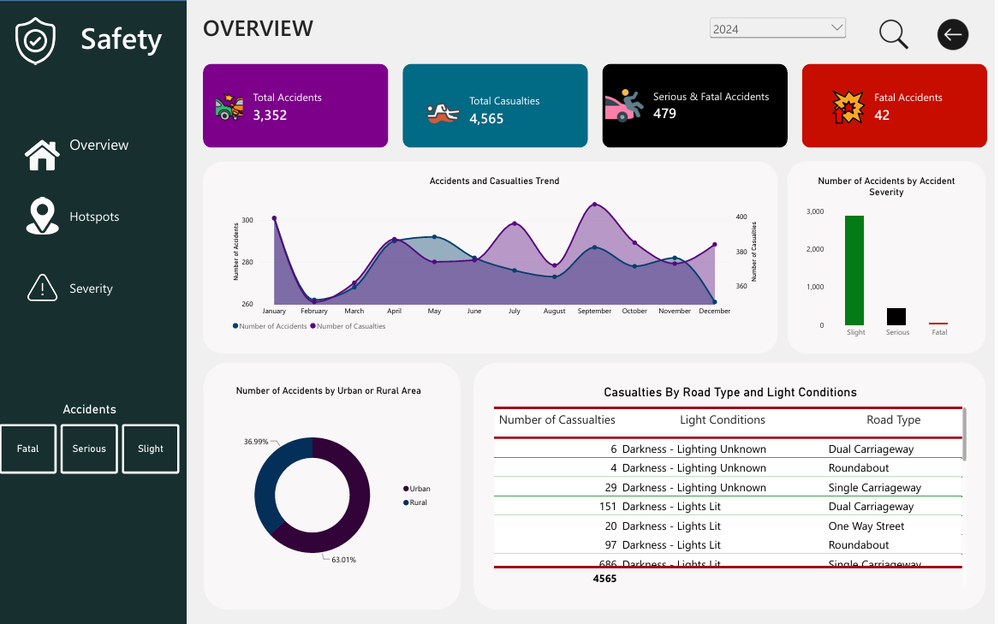
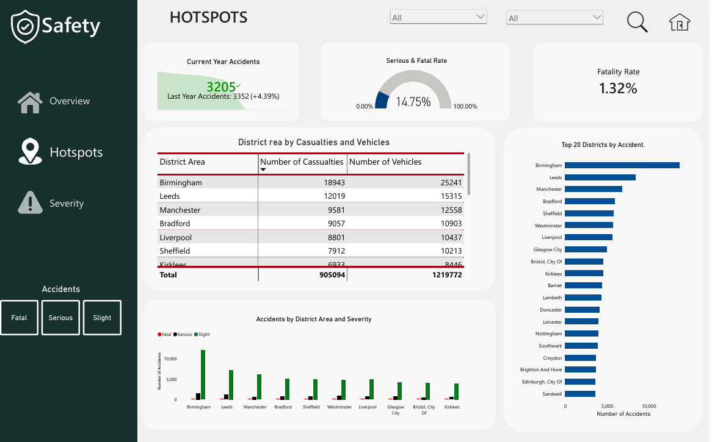
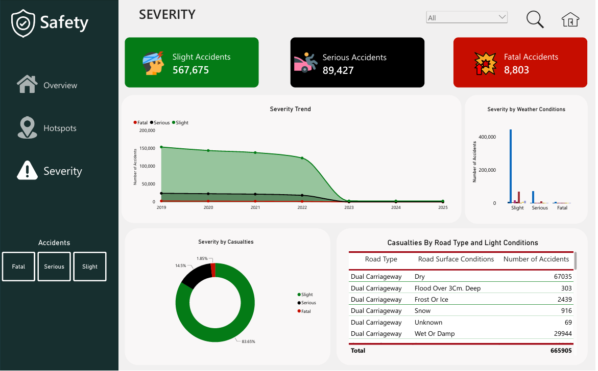

# Road Safety Analysis

### Turning Road Accident Data into Actionable Safety Insights

Road accidents remain a significant public safety concern, with their frequency, severity, and distribution varying across locations and road conditions. Identifying accident patterns and high-risk areas is essential for road safety authorities to understand where attention is needed and how interventions can be prioritised.

This project applies data analytics using Python, SQL, and Power BI to transform road accident records into meaningful insights. Through data cleaning, exploratory analysis, and interactive visualisation, it examines accident trends, severity patterns, casualty figures, and geographical hotspots, providing insights that can support authorities in making informed, data-driven decisions.

---

## Dashboard Preview

The project features an interactive Power BI dashboard organised into three analytical pages.

### 1. Overview

Provides a high-level summary of road accident activity through key performance indicators, accident trends, severity distribution, and district-level analysis.



### 2. Accident Hotspots

Examines accident concentrations across districts to identify high-risk locations and areas that may require prioritised road safety interventions.



### 3. Accident Severity

Explores accident severity patterns and examines how road types, weather conditions, and other factors relate to accident outcomes.



---

## Tools and Technologies

| Technology | Application |
|---|---|
| Python | Data cleaning and preparation |
| Pandas | Data manipulation and transformation |
| SQL | Data exploration and analysis |
| Power BI | Data visualisation and dashboard development |

## Project Workflow

### 1. Data Cleaning and Preparation — Python

- Inspected the raw accident dataset.
- Identified and handled missing values and inconsistencies.
- Cleaned and transformed relevant columns.
- Prepared the dataset for further analysis.

### 2. Data Exploration — SQL

- Analysed accident distributions and severity.
- Examined casualty and vehicle involvement.
- Investigated district-level accident concentrations.
- Explored patterns across road and environmental conditions.

### 3. Dashboard Development — Power BI

- Developed a three-page interactive dashboard.
- Created key performance indicators.
- Analysed accident trends and severity patterns.
- Designed visualisations to communicate findings clearly.

---

## Key Areas of Analysis

- **Accident Trends:** Changes in accident occurrences over time.
- **Accident Hotspots:** Districts with high accident concentrations.
- **Accident Severity:** Distribution of slight, serious, and fatal accidents.
- **Road Characteristics:** Accident patterns across different road types and surface conditions.
- **Environmental Conditions:** Accident patterns across weather and lighting conditions.
- **Casualty Analysis:** The number of casualties resulting from recorded accidents.

## Key Findings

- Accident occurrence is concentrated in certain districts, highlighting geographical differences in road safety.
- Slight accidents account for the largest share of recorded accidents.
- Urban areas account for a greater proportion of accidents than rural areas.
- Single carriageways record a substantial number of accidents.
- Weather, lighting, and road surface conditions provide additional dimensions for examining accident severity.

*These findings describe observed patterns in the dataset and should not be interpreted as proof of causation.*

---

## Repository Structure

```text
## Repository Contents

| File | Description |
|---|---|
| [R.Overview.png](R.Overview.png) | Overview dashboard screenshot |
| [R.Hotspots.png](R.Hotspots.png) | Accident hotspots dashboard screenshot |
| [R.Severity.png](R.Severity.png) | Accident severity dashboard screenshot |
| [Road Safety.ipynb](Road%20Safety.ipynb) | Python notebook for data cleaning and preparation |
| [Road Safety Queries.sql](Road%20Safety%20Queries.sql) | SQL queries for data exploration and analysis |
| [Road Safety Dashboard.pbix](Road%20Safety%20Dashboard.pbix) | Interactive Power BI dashboard |
